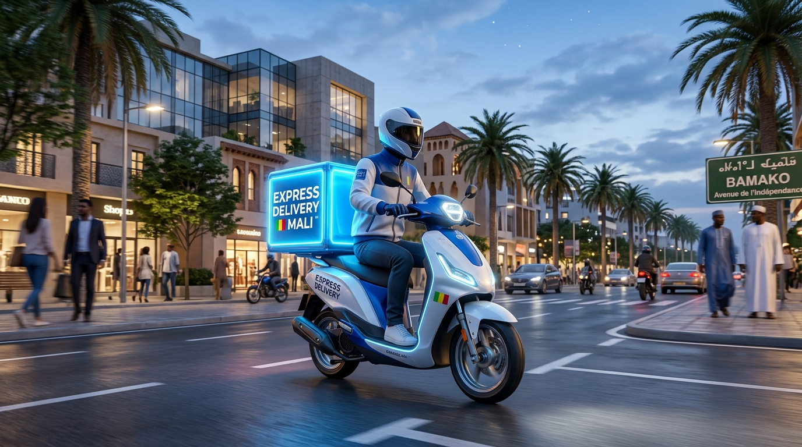

# ⚡ livrEXPRESS - Landing Page

Landing page moderne et responsive pour **livrEXPRESS**, entreprise de livraison express et sécurisée à **Bamako (Mali)**.



---

## 🚀 Fonctionnalités principales

- **Hero Section dynamique** :
  - Titre percutant, sous-titre contextualisé aux quartiers de Bamako (ACI 2000, Badalabougou, Hamdallaye, Yirimadio).
  - Boutons d'action (CTA) avec micro-animations.
  - Visuel 3D moderne d'un coursier avec badges flottants d'état en direct et modes de paiement (Orange Money, Moov Money, Espèces).
  - Indicateurs de confiance clés (< 45 min, +15 000 colis, 4.9/5 satisfaction).
- **Comment ça marche en 3 étapes** :
  1. *Commandez en 1 clic* (devis immédiat).
  2. *Collecte & Suivi en direct* (collecte sous 15 min, traçabilité).
  3. *Livraison sécurisée* (code PIN SMS secret et signature).
- **Tarifs clairs & Simulateur instantané** :
  - **Simulateur interactif** de courses calculant les prix selon les communes de départ et d'arrivée et le type de colis.
  - **Course Standard** (Particuliers & Flash) : `1 500 FCFA` / course.
  - **Pack Pro & Vendeurs** (E-commerce & Boutiques) : `1 000 FCFA` / course avec reversement COD le jour même.
  - **VIP & Périphérie** (Kati, Koulikoro, Sénou, Samanko) : `3 000 FCFA` / course.
- **Témoignages clients** : 3 avis vérifiés d'entrepreneurs et particuliers à Bamako avec photos et notations étoiles.
- **Bannière d'action & Footer complet** :
  - Coordonnées locales à Bamako (Immeuble Sahel, ACI 2000).
  - Numéros de téléphone directs (+223 70 00 12 34), email et horaires 7j/7.
  - Réseaux sociaux : Facebook, Instagram, LinkedIn, TikTok, WhatsApp.
  - Bouton flottant WhatsApp toujours accessible.
- **Modal interactif de réservation** :
  - Formulaire de réservation rapide avec calcul automatique du devis et redirection pré-remplie vers WhatsApp.

---

## 🎨 Design & Technologies

- **Design System** : Palette moderne **Bleu Royal & Blanc** (`#1D68F2`, `#0066FF`, `#0A2158`, `#FFFFFF`), verre dépoli (*glassmorphism*), lueurs douces et micro-interactions.
- **Mobile-First & Responsive** : Optimisé pour tous les écrans (smartphones, tablettes, ordinateurs de bureau).
- **Technologies** :
  - **HTML5** sémantique
  - **CSS3** vanilla (variables CSS, flexbox, CSS grid, keyframe animations)
  - **JavaScript** vanilla (simulateur de tarifs, modale, menu mobile)
  - **Typographie Google Fonts** : *Outfit* (Titres) et *Plus Jakarta Sans* (Corps de texte)

---

## 💻 Lancer le projet en local

Il suffit d'ouvrir le fichier `index.html` dans n'importe quel navigateur, ou d'utiliser le serveur local PowerShell inclus :

```powershell
powershell -ExecutionPolicy Bypass -File .\server.ps1
```

Puis rendez-vous sur `http://localhost:8080`.

---

## 📄 Licence

Projet développé pour **livrEXPRESS Mali**. Tous droits réservés.
